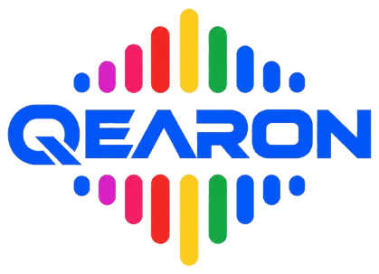
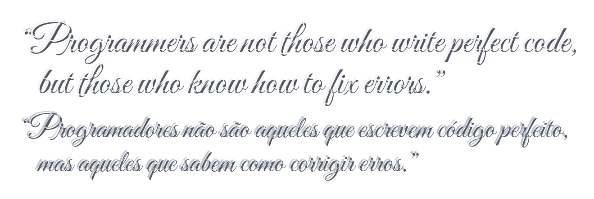

<div align="center">

<a href="#qearon-autonomous-low-level-audio-orchestrator-for-linux">
  
</a>

# Qearon: Autonomous Low-Level Audio Orchestrator for Linux

<pre align="center">
  ██████╗ ███████╗ █████╗ ██████╗  ██████╗ ███╗   ██╗
 ██╔═══██╗██╔════╝██╔══██╗██╔══██╗██╔═══██╗████╗  ██║
 ██║   ██║█████╗  ███████║██████╔╝██║   ██║██╔██╗ ██║
 ██║▄▄ ██║██╔══╝  ██╔══██║██╔══██╗██║   ██║██║╚██╗██║
 ╚██████╔╝███████╗██║  ██║██║  ██║╚██████╔╝██║ ╚████║
  ╚══▀▀═╝ ╚══════╝╚═╝  ╚═╝╚═╝  ╚═╝ ╚═════╝ ╚═╝  ╚═══╝
</pre>

<p align="center">
  
</p>

<table align="center" style="border: none; background: transparent;">
  <tr>
    <td align="center" width="180">
      <a href="https://www.instagram.com/rafasecnerd">
        
      </a>
      <br />
      <b>Rafaela De Lima</b>
      <br />
      
    </td>
    <td align="center" width="180">
      <a href="CONTRIBUTING.md">
        
      </a>
      <br />
      <a href="CONTRIBUTING.md"><b>Espaço Aberto</b></a>
      <br />
      <a href="CONTRIBUTING.md"></a>
    </td>
  </tr>
</table>

<p align="center">
  <a href="https://www.tiktok.com/@rafasecnerd"></a>
  <a href="https://www.instagram.com/rafasecnerd"></a>
  <a href="https://www.youtube.com/@rafasecnerd"></a>
  &nbsp;|&nbsp;
  
  
</p>

<p align="center">
  
  
  
  
  
</p>

<p align="center">
  <sub>✨ <b>[PT-BR]</b> <i>Contribua com o projeto e ganhe sua foto aqui ao lado da minha! Veja as <a href="CONTRIBUTING.md">Diretrizes de Contribuição</a>.</i><br />
  ✨ <b>[EN]</b> <i>Contribute to the project and have your photo featured right here next to mine! See the <a href="CONTRIBUTING.md">Contributing Guidelines</a>.</i></sub>
</p>

</div>

---

## Sumário / Table of Contents
- [[PT-BR] Visão Geral em Português](#pt-br-português)
  - [Origem e Significado do Nome (Trocadilho "Clear On")](#origem-e-significado-do-nome)
  - [História e Motivação Autoral](#história-e-motivação)
  - [Stack Tecnológica Utilizada](#stack-tecnológica-utilizada)
  - [Arquitetura e Purismo em Zig](#arquitetura-e-purismo-em-zig)
  - [Funcionalidades Principais](#funcionalidades-principais)
  - [Compilação e Instalação](#compilação-e-instalação)
- [[EN] English Overview](#en-english)
  - [Name Origin and Etymology (The "Clear On" Pun)](#name-origin-and-etymology)
  - [Authorial Backstory and Genesis](#backstory-and-purpose)
  - [Technology Stack Matrix](#technology-stack-matrix)
  - [Systems Architecture & Zig Purity](#systems-architecture--zig-purity)
  - [Core Capabilities](#core-capabilities)
  - [Building and Installation](#building-and-installation)
- [Documentação e Recursos / Resources](#documentação-e-recursos--resources)

---

## [PT-BR] Português

### Origem e Significado do Nome
O nome **Qearon** é um trocadilho fonético com a expressão em língua inglesa **"Clear On"** (cuja pronúncia soa praticamente idêntica). O termo sintetiza o propósito do projeto: ligar o som com clareza imediata e cristalina, sem ruído elétrico de retorno analógico ou configurações manuais frustrantes.

### História e Motivação
A ideia do Qearon nasceu de uma experiência real e bastante frustrante pela qual passei: ao conectar meu fone de ouvido headset com microfone integrado em minha estação de trabalho Linux, o microfone simplesmente não era detectado e não emitia qualquer áudio. O sistema operacional insistia em manter rotas padrão desconectadas enquanto os canais de ganho físico permaneciam mudos nos registradores do codec da placa-mãe.

Resolver essa falha me custou horas de pesquisa em comandos ALSA de baixo nível, testes de mixer e manipulação de sockets. Ao constatar que esse mesmo "trabalhinho chato" atinge inúmeros desenvolvedores e criadores de conteúdo no Linux, decidi construir uma solução definitiva, autônoma e de alto nível de engenharia, para que ninguém mais precise passar por esse aborrecimento.

### Stack Tecnológica Utilizada

| Camada do Sistema | Tecnologia Adotada | Finalidade Técnica |
| :--- | :--- | :--- |
| **Linguagem Principal** | **Zig (0.13.0+)** | Compilação nativa determinística, zero coletor de lixo e controle estrito de memória. |
| **Camada de Kernel** | **ALSA (`/proc/asound`)** | Descoberta dinâmica de placa primária, Jack Sensing multi-tier (ALSA cget + procfs codec) e calibração de ganhos físicos. |
| **Grafo Multimídia** | **PipeWire & WirePlumber** | Descoberta dinâmica de IDs e nós (sem PCI IDs fixos), roteamento de streams com latência sub-milissegundo. |
| **Processamento Local** | **`pw-loopback` via PID isolado** | Monitoramento de sidetone isolado (`/tmp/qearon_loopback.pid`), término seguro via `kill -15` e supressão de ruído nativa. |
| **Terminal ANSI** | **Raw Virtual Terminal (VT100)** | Renderização de VU-meter RMS real simétrico (`<[ ||||.... ▲ ....|||| ]>`) em tempo real com gradientes ANSI e detecção de picos. |

### Arquitetura e Purismo em Zig
Projetei o Qearon sob o padrão de **Monorepo Modular Linear**, priorizando rigor técnico e Clean Code:
- **Purismo Estrito em Zig**: 100% desenvolvido em Zig puro. Não utilizo bibliotecas dinâmicas de terceiros, runtimes pesados ou frameworks inchados.
- **Isolamento de Responsabilidades**: Subsistemas modulares e independentes (`alsa`, `pipewire`, `detector`, `loopback`, `vumeter`, `i18n`, `ui`, `autofix`, `watcher`, `tester`, `installer`, `sys`).
- **Resolução Dinâmica de Topologia**: Eliminação total de strings PCI ou rotas fixas hardcoded; IDs e nomes de endpoints analógicos e HDMI são resolvidos dinamicamente via `pw-dump` e `/proc/asound`.
- **Isolamento de Processos**: Monitoramento via Loopback com arquivo de PID dedicado e sinalização POSIX controlada, abolindo comandos globais destrutivos como `pkill`.
- **Internacionalização Centralizada**: Nenhuma string hardcoded nos módulos de lógica. Todas as mensagens são resolvidas em tempo de execução via `src/i18n.zig` com base na localidade configurada em `~/.config/qearon/lang`.
- **Tolerância a Falhas**: Princípio de degradação suave com fallback gracioso para comandos ALSA e saída com códigos de terminação POSIX canônicos (0=Sucesso, 1=Sintaxe, 2=Hardware).

### Funcionalidades Principais

| Comando | Descrição Operacional |
| :--- | :--- |
| `qearon autofix` | Executa a rotina autônoma em 6 etapas: audita conexões físicas dinâmicas (Jack Sensing), desmuta canais mestre e captura, calibra ganho em 80% (+20dB boost), elimina vazamento analógico e restaura rotas PipeWire. |
| `qearon status` | Audita o estado de hardware ALSA e exibe a topologia ativa dos nós de áudio do servidor PipeWire de forma filtrada e sem duplicações. |
| `qearon vu` | Renderiza um medidor de volume (VU-meter) em tempo real no terminal, utilizando cálculo matemático RMS ($\sqrt{\frac{1}{N}\sum x_i^2}$) com barra simétrica dual-wing e indicador de pico. |
| `qearon loopback on/off` | Ativa ou encerra o retorno de voz de baixíssima latência (monitoramento em tempo real) via PID isolado com terminação segura `kill -15`. |
| `qearon denoise on/off` | Ativa e remove dinamicamente o módulo nativo de cancelamento de eco e supressão de ruído no PipeWire (`pw-cli destroy <id>`). |
| `qearon headset` | Força dinamicamente o chaveamento das rotas de áudio analógicas para conexão combinada tipo headset (TRRS). |

### Compilação e Instalação

#### Pré-requisitos
- Compilador **Zig** (versão 0.13.0 ou superior).
- Servidor de áudio **PipeWire** em execução.

#### Compilação a partir do Código-Fonte
```bash
# Clonar o repositório
git clone https://github.com/rafasecnerd/qearon.git
cd qearon/qearon

# Compilar em modo release seguro
zig build -Doptimize=ReleaseSafe

# Instalar o binário no sistema
sudo install -m 755 ./zig-out/bin/qearon /usr/local/bin/qearon
```

---

## [EN] English

### Name Origin and Etymology
The name **Qearon** is a phonetic pun on the English phrase **"Clear On"** (which sounds virtually identical). It embodies the central goal of this software: turning sound on with immediate crystal-clear acoustic quality, zero analog noise bleed, and without requiring cumbersome manual trial-and-error.

### Backstory and Purpose
The genesis of Qearon arose from an irritating empirical hurdle I personally faced: upon plugging my 3.5mm headset into my Linux desktop motherboard, the microphone went entirely undetected, producing complete silence. The operating system defaulted to orphaned endpoints while input boost registers remained muted deep inside the hardware codec silicon.

Resolving this defect required hours of low-level ALSA commands, register debugging in procfs, and mixer reconfiguration. Realizing that this tedious friction is a recurring headache shared by Linux developers, engineers, and creators, I decided to engineer a definitive, automated, and mathematically sound systems tool so that no one ever has to suffer through that troubleshooting process again.

### Technology Stack Matrix

| System Layer | Technology | Engineering Role |
| :--- | :--- | :--- |
| **Core Systems Language** | **Zig (0.13.0+)** | Deterministic compilation, zero garbage collection pauses, and explicit memory safety. |
| **Kernel Subsystem** | **ALSA (`/proc/asound`)** | Dynamic sound card discovery, multi-tier physical Jack Sensing (ALSA cget + procfs codec), and analog preamplifier gain register calibration. |
| **Multimedia Graph** | **PipeWire & WirePlumber** | Dynamic node/route resolution (zero hardcoded PCI paths), sub-millisecond dynamic audio stream routing. |
| **Process Daemon** | **`pw-loopback` via Isolated PID** | Process-isolated voice monitoring (`/tmp/qearon_loopback.pid`), graceful `kill -15` teardown, and native PipeWire echo cancellation module control. |
| **Terminal Graphics** | **VT100 ANSI Escape Sequences** | Real-time true RMS audio visualizer (`<[ ||||.... ▲ ....|||| ]>`) with dual-wing symmetric meter and peak indicators. |

### Systems Architecture & Zig Purity
I engineered Qearon under a **Linear Modular Monorepo** architecture, emphasizing deterministic execution and Clean Code:
- **Pure Zig Language Architecture**: Built 100% in pure Zig. No dynamic third-party libraries, no hidden runtime overhead, and no garbage collection pauses.
- **Modular Decoupling**: Discrete functional domains (`alsa`, `pipewire`, `detector`, `loopback`, `vumeter`, `i18n`, `ui`, `autofix`, `watcher`, `tester`, `installer`, `sys`).
- **Dynamic Topology Resolution**: Complete elimination of hardcoded PCI identifiers or static route indices; audio endpoints are discovered at runtime via `pw-dump` and ALSA procfs.
- **Process Isolation**: Voice loopback tracking via dedicated PID tracking files and target-specific POSIX signaling, avoiding blunt global process kills.
- **Centralized Internationalization**: Zero hardcoded strings across application logic. Messages are resolved dynamically via `src/i18n.zig` based on the active runtime locale in `~/.config/qearon/lang`.
- **Fault Tolerance**: Graceful degradation with standard POSIX exit codes (0=Success, 1=Syntax/Usage, 2=Hardware Error).

### Core Capabilities

| Command | Operational Purpose |
| :--- | :--- |
| `qearon autofix` | Executes autonomous 6-stage remediation: dynamic Jack Sensing audit, ALSA playback and capture unmuting, gain calibration to 80% (+20dB boost), analog bleed elimination, and dynamic PipeWire stream synchronization. |
| `qearon status` | Audits physical ALSA codec pin states and maps live PipeWire node topologies without duplicate sections. |
| `qearon vu` | Displays a real-time terminal VU-meter with true mathematical RMS ($\sqrt{\frac{1}{N}\sum x_i^2}$) calculation, dual-wing symmetric ANSI bars, and peak indicator. |
| `qearon loopback on/off` | Toggles sub-millisecond voice monitoring using isolated PID management with safe POSIX termination. |
| `qearon denoise on/off` | Dynamically loads and natively destroys PipeWire active noise and acoustic echo cancellation filter nodes (`pw-cli destroy <id>`). |
| `qearon headset` | Dynamically forces combined TRRS analog routing for integrated headset jacks. |

### Building and Installation

#### Prerequisites
- **Zig Compiler** (version 0.13.0 or higher).
- Active **PipeWire** audio daemon.

#### Building from Source
```bash
# Clone the repository
git clone https://github.com/rafasecnerd/qearon.git
cd qearon/qearon

# Compile in safe release mode
zig build -Doptimize=ReleaseSafe

# Install the binary system-wide
sudo install -m 755 ./zig-out/bin/qearon /usr/local/bin/qearon
```

---

## Documentação e Recursos / Resources

- [Documentação Central / Docs Hub](docs/README.md)
- [Diagrama C4 da AST do Monorepo](docs/diagrama_c4_ast.md)
- [Artigo Científico Acadêmico / Technical Writeup](writeup/README.md)
- [Diretrizes de Contribuição / Contributing](CONTRIBUTING.md)
- [Código de Conduta / Code of Conduct](CODE_OF_CONDUCT.md)
- [Canal Oficial de Suporte / Support](SUPPORT.md)
- [Política de Segurança / Security Policy](SECURITY.md)
- [Modelo de Governança / Governance](GOVERNANCE.md)
- [Registro de Alterações / Changelog](CHANGELOG.md)
- [Roteiro de Recursos Futuros / Roadmap](ROADMAP.md)
- [Formato de Citação Científica / Citation (CFF)](CITATION.cff)

---

<table align="center" style="border: none; background: transparent;">
  <tr>
    <td align="center" valign="bottom" width="260" style="border: none; background: transparent;">
      <a href="https://pt.wikipedia.org/wiki/Barbara_Liskov" target="_blank" rel="noopener noreferrer">
        
      </a>
    </td>
    <td valign="middle" style="border: none; background: transparent; padding-left: 20px;">
      <picture>
        <source media="(prefers-color-scheme: dark)" srcset="assets/barbara_quote_dark.png">
        <source media="(prefers-color-scheme: light)" srcset="assets/barbara_quote_light.png">
        
      </picture>
      <br />
      <p>
        — <b><a href="https://pt.wikipedia.org/wiki/Barbara_Liskov">Barbara Liskov</a></b><br />
        <sub>Cientista da Computação, vencedora do Prêmio Turing e criadora do Princípio da Substituição de Liskov (LSP).<br />
        Computer Scientist, Turing Award winner, and creator of the Liskov Substitution Principle (LSP).</sub>
      </p>
    </td>
  </tr>
</table>

---

Desenvolvido por / Developed by: **[Rafaela De Lima (@rafasecnerd)](https://www.instagram.com/rafasecnerd)** ([TikTok](https://www.tiktok.com/@rafasecnerd) | [Instagram](https://www.instagram.com/rafasecnerd) | [YouTube](https://www.youtube.com/@rafasecnerd))
