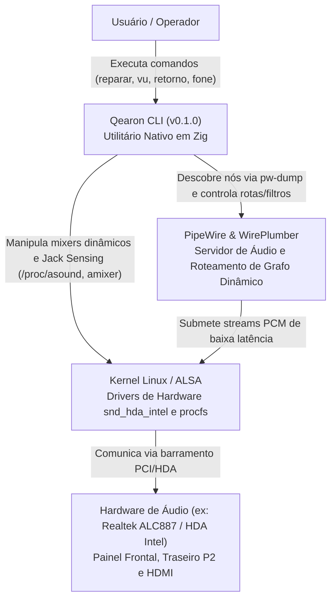
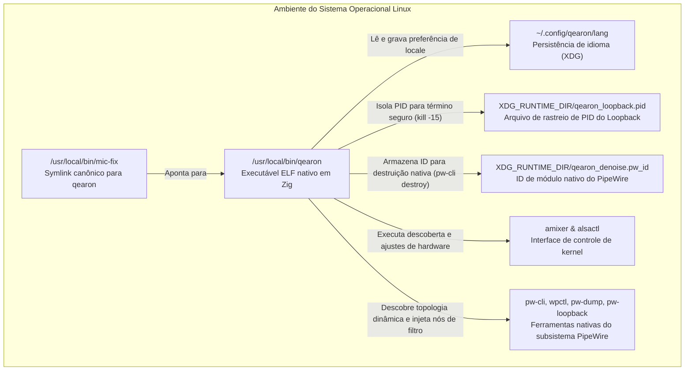
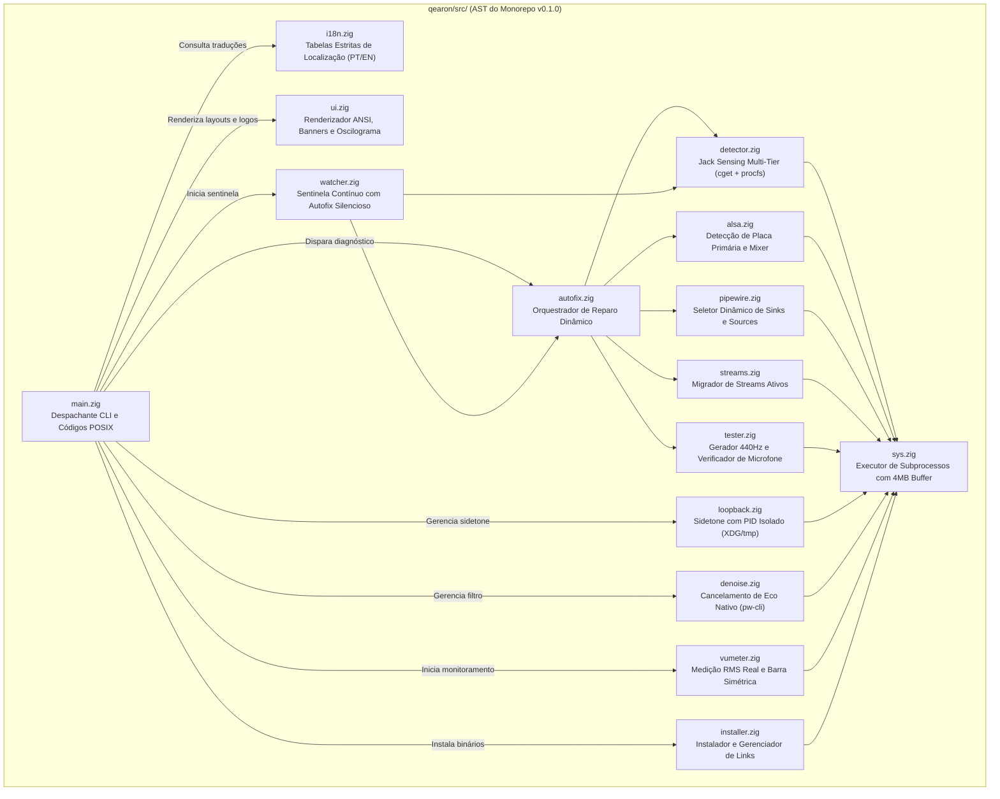

# Modelo C4 e Análise de AST / C4 Model and AST Analysis

Desenvolvido por / Developed by: **[Rafaela De Lima (@rafasecnerd)](https://www.instagram.com/rafasecnerd)** ([TikTok](https://www.tiktok.com/@rafasecnerd) | [Instagram](https://www.instagram.com/rafasecnerd) | [YouTube](https://www.youtube.com/@rafasecnerd))  
Versão do Software / Software Version: **v0.1.0**

---

## [PT-BR] Português

O modelo C4 (Contexto, Contêineres, Componentes e Código) fornece uma representação hierárquica e formal da arquitetura do Qearon. Esta análise mapeia com precisão matemática a Árvore Sintática Abstrata (AST) do código-fonte compilado em Zig.

### Nível 1: Diagrama de Contexto de Sistema
Descreve as fronteiras do Qearon em relação ao usuário, ao kernel Linux (ALSA) e ao servidor de áudio moderno (PipeWire / WirePlumber).

---

### Nível 2: Diagrama de Contêineres
Mapeia a distribuição do software no sistema operacional, a camada de persistência e os canais IPC.

---

### Nível 3: Diagrama de Componentes (Mapeamento da AST)
Reflete a estrutura modular sequencial e a hierarquia exata de chamadas de funções entre os módulos de `qearon/src/`.

---

## [EN] English

The C4 model (Context, Containers, Components, and Code) provides an architectural decomposition of Qearon. This breakdown is mathematically derived from the Abstract Syntax Tree (AST) of the Zig codebase.

### Level 1: System Context Diagram
Defines Qearon's boundaries in relation to the operator, Linux kernel (ALSA), and modern audio infrastructure (PipeWire / WirePlumber).

- **User**: Invokes commands such as `autofix`, `vu`, `loopback`, `denoise`, and `headset`.
- **Qearon CLI**: Autonomous Zig binary (v0.1.0) responsible for dynamically auditing and orchestrating audio routes.
- **ALSA Kernel**: Kernel audio drivers controlling hardware mixers, sound cards, and procfs Jack Sensing states.
- **PipeWire / WirePlumber**: High-performance audio graph engine handling dynamic stream routing without static PCI paths.

### Level 2: Container Diagram
Details runtime deployment, IPC interfaces, and storage artifacts.

- **Executable**: Compiled binary installed at `/usr/local/bin/qearon` with `/usr/local/bin/mic-fix` alias.
- **Locale Configuration**: Persistent preference stored at `~/.config/qearon/lang` (XDG standard) with fallback to `/tmp/.qearon_prefer`.
- **Process Isolation State**: Active loopback PID persisted at `XDG_RUNTIME_DIR/qearon_loopback.pid` (with fallback to `/tmp`) for deterministic POSIX `kill -15` management.
- **PipeWire Native Module Tracking**: Loaded echo-cancellation module ID tracked at `XDG_RUNTIME_DIR/qearon_denoise.pw_id` (with fallback to `/tmp`) for deterministic destruction via `pw-cli destroy <id>`.
- **System Tooling**: Subprocess execution targeting `amixer`, `wpctl`, `pw-dump`, and `pw-loopback`.

### Level 3: Component Diagram (AST Decomposition)
Reflects the exact call graph and modular isolation in `qearon/src/`.

- `main.zig`: Application entry point, argument parsing, strict POSIX exit code dispatching (0=Success, 1=Syntax, 2=Hardware).
- `ui.zig`: Pure ANSI presentation engine, box drawing, and spectrum wave visualization.
- `i18n.zig`: Centralized compile-time string dictionary isolating PT-BR and EN, supporting XDG directory resolution.
- `autofix.zig`: Autonomous 6-stage remediation engine coordinating dynamic sound cards, sinks, sources, and routes.
- `detector.zig`: Multi-tier Jack Sensing (ALSA control cget `iface=CARD,name='* Jack'`, procfs codec pin-ctls, pw-dump fallback).
- `alsa.zig`: Dynamic primary card discovery via `/proc/asound/cards`, hardware gain calibration, analog bleed muting, and mixer control.
- `pipewire.zig`: Locale-independent, dynamic sink/source and route index resolver using `pw-dump` (zero hardcoded PCI strings).
- `streams.zig`: Live audio client stream migration without playback interruptions.
- `tester.zig`: Non-blocking 440 Hz acoustic tone emission and self-recording routines using `XDG_RUNTIME_DIR`.
- `vumeter.zig`: Real-time PCM stream sampler with true mathematical RMS ($\sqrt{\frac{1}{N}\sum x_i^2}$) calculation and dual-wing symmetric ANSI visualizer.
- `loopback.zig`: Sub-millisecond hardware sidetone manager with dedicated PID tracking and safe POSIX signaling.
- `denoise.zig`: Real-time acoustic echo cancellation with native PipeWire module tracking and removal.
- `watcher.zig`: Polling event loop detecting hardware plug/unplug events with silent autofix remediation.
- `installer.zig`: System-wide binary installation and symlink management (`qearon` and `mic-fix`).
- `sys.zig`: Memory-safe subprocess execution layer with pipe isolation and 4MB buffer capacity.

---

Desenvolvido por / Developed by: **[Rafaela De Lima (@rafasecnerd)](https://www.instagram.com/rafasecnerd)** ([TikTok](https://www.tiktok.com/@rafasecnerd) | [Instagram](https://www.instagram.com/rafasecnerd) | [YouTube](https://www.youtube.com/@rafasecnerd))
